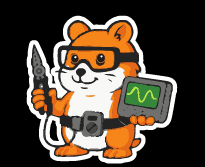

# Kode Avatar + the Hammie face pack

Make your own animated avatar for the Kode Dot, or install Hammie, the orange hamster with goggles
from the original sticker. An avatar takes Kody's place on the face, the empty launcher, the
"writing" and "goodbye" cards and the loading screen.

## Make your own avatar

**[Open the Kode Avatar app](https://rein033.github.io/hammie-pack/app/)** · [step-by-step guide](docs/AVATAR.md)

1. Describe your character.
2. For each animation, copy the ready-made prompt into **Claude** or **ChatGPT**.
3. Paste the answer back. The app plays it and checks it with kodeOS's own pack rules.
4. Download the face pack and copy it to a microSD card.

Only *Wake up* and *Idle* are needed. It runs in your browser; nothing is uploaded. You can also
start from Hammie and replace the animations you want.

## Hammie

Hammie is the example avatar, made by hand from the sticker (see [How it is made](#how-it-is-made)).

> [!WARNING]
> **Not tested on an official Kode Dot yet.** The pack passes kodeOS's own pack checks
> (`kui_pack.c` from the SDK, built for a PC, see [tools/packcheck](tools/packcheck)). The previews
> are rendered on a PC. Nobody has run it on real hardware yet. Install it at your own risk. If it
> plays, or if it does not, please open an issue with what you saw.

> [!NOTE]
> This is a fan project. It is not made, checked or supported by Kode. Kode, Kode Dot, kodeOS and
> Kody are names of Kode. Hammie and the sticker he is traced from are Kode's artwork.

| idle | joke |
|---|---|
|  |  |
| **notice** | **hour** |
|  |  |

The previews are the real size on the Dot's screen, on black. The other animations are in
[`preview/`](preview).

## What is in the pack

| File | Where the Dot plays it | Canvas |
|---|---|---|
| `wake.json.z` | the face wakes up | 410 x 334 |
| `idle.json.z` | the face, looping | 410 x 334 |
| `look.json.z` | he looks at you | 410 x 334 |
| `hour.json.z` | on the hour: a clock on his scope | 410 x 334 |
| `notice.json.z` | a notification | 410 x 334 |
| `charge.json.z` | the cable is plugged in | 410 x 334 |
| `joke.json.z`, `sleep.json.z` | the scene's joke: he laughs, or he dozes off | 410 x 334 |
| `doubt.json.z` | the launcher with no apps | 410 x 369 |
| `work.json.z` | the card while an app is written | 410 x 160 |
| `bye.json.z` | the card before an app starts | 410 x 160 |
| `loading.json.z` | the loading screen | 264 x 264 |

`kode.json` is the manifest (format 1). It lists every file with its SHA-256.

## Install

There are two ways. You need kodeOS with face packs (the Kody pack). The SD card is the
easiest.

### A. With a microSD card

1. Format the card as FAT32 if it is new.
2. Make a folder `kode` at the root of the card.
3. Copy **everything in [`pack/`](pack)** into it: `kode.json` and the twelve `.json.z` files. The
   card must now hold `/kode/kode.json`, not `/kode/pack/kode.json`.
4. Put the card in the Dot and restart it.

The Dot looks for a pack on the card first (`/sdcard/kode/`) and uses its own one
(`/storage/kode/`) when there is none. **Back to Kody:** take the card out, or delete the `kode`
folder from it, and restart.

### B. Over Wi-Fi, from this repository

The Dot downloads the pack and installs it in its own flash (`/storage/kode/`), so no card is
needed. The Dot must be on Wi-Fi.

1. Connect the Dot to your computer with a USB-C cable, and open its console in a serial terminal
   (any baud rate), for example:

   ```bash
   screen /dev/ttyACM0 115200
   ```

   On macOS the port is `/dev/cu.usbmodem…`. On Windows it is a COM port; use PuTTY.
2. Type this line and press Enter:

   ```
   function name="assets_update" arg="https://raw.githubusercontent.com/Rein033/hammie-pack/main/pack/kode.json"
   ```

   The Dot fetches `kode.json` and every file next to it, checks each one, and switches to
   Hammie. The answer ends with `>ok`, or with `>err …` when something was refused.

**Update to a newer Hammie:** type the same `assets_update` line again. The Dot downloads the
new pack. With method A, copy the new `pack/` onto the card again.

**Back to Kody:** the same command without `arg`. It installs Kode's official pack again:

```
function name="assets_update"
```

### Useful console commands

| Command | What it does |
|---|---|
| `function name="assets_check" arg=sd` | checks the pack on the card without installing it (`arg=fat` for the one in flash) |
| `function name="assets_try" arg="joke.json.z"` | plays one animation of the active pack now |
| `function name="assets_reload"` | chooses and loads the pack again (after you swap the card) |
| `function_list` | lists every function your kodeOS has, if a name above is different |

## Check a pack yourself

[`tools/packcheck`](tools/packcheck) runs kodeOS's own checks (`kui_pack.c`) on a pack folder on
your computer. It checks the manifest, the canvas of each role, the size limits (64 KB stored,
96 KB of JSON), the frame rate, the frame count and the depth.

```bash
git clone https://github.com/kodediy/kode-sdk
cd tools/packcheck && ./build.sh ../../kode-sdk && ./packcheck ../../pack
```

## How it is made

`src/` holds the tools that made the pack:

1. `vectorize2.py` cuts the sticker into four parts (body, head, pliers arm, scope arm), the same
   way the Kode Watch animations do (`hamorig.py`). It reduces each part to the sticker's eight
   colours (`vectorize.py`) and traces them with [vtracer](https://github.com/visioncortex/vtracer)
   into smooth Bezier shapes. The face is traced at the finest resolution, because the Dot allows
   only 96 KB of JSON per animation. The result is `hammie_vectors.json`, which is in this
   repository.
2. `dotrig.py` turns each part into a layer that turns on its own pivot, over a white sticker edge
   of its own. Eyes, mouth, the scope's screen and the props are vector shapes on top. The poses
   are the Kode Watch's (`hamorig.py`), sampled into keyframes.
3. `dotpack.py` makes the JSON smaller, compresses each file with zlib and writes `kode.json` with
   the SHA-256 of each file. It stops if a file is over the Dot's limits.

```bash
pip install numpy pillow opencv-python-headless lottie resvg-py vtracer
python src/vectorize2.py src/hammie_vectors.json --scale 0.6 --s-head 0.85 --s-body 0.45 \
  --s-pliers 0.6 --s-scope 0.5 --speckle 5 --shade-min 500 --corner 90 --splice 90
python src/dotrig.py src/hammie_vectors.json build/lottie     # needs the sticker image: see below
python src/dotpack.py build/lottie pack 2026.11.25.1
python src/preview.py build/lottie preview                    # the GIFs above
```

`vectorize2.py` and `dotrig.py` read the original sticker image through `hamorig.py`, for the
pivots and the screen's place. That image is Kode's artwork, so it is not in this repository. Set
`HAMMIE_REF=/path/to/reference.png` if you have it.

## Licence

The code in `app/`, `src/` and `tools/` is MIT. The pack, the previews and `hammie_vectors.json` are a
trace of Kode's sticker. They are shared here for Kode Dot owners to use on their own device. If
Kode asks, they come down.
